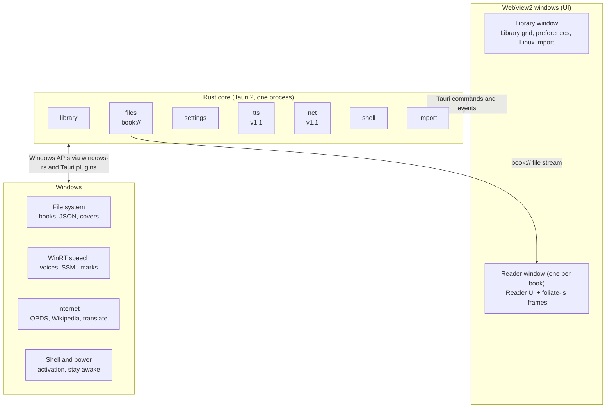

# Foliate for Windows — Migration Spec (Option B)

Oct 22, 2026 · @Andreas Gosch

## Overview

Foliate becomes a native Windows 10/11 app by keeping its e-book engine, `foliate-js`, and rebuilding the GTK/GJS shell around it as a web UI in a desktop web-view framework. WebKitGTK, which renders every book today, has no Windows port, so the GTK shell cannot be reused as-is.

**In scope**

- A Windows desktop app with feature parity with Foliate 3.3.0 (the `gtk4` branch), except items marked as dropped in the feature inventory.
- Reuse of `foliate-js` (the `src/foliate-js` submodule) and the in-page code under `src/reader`, `src/opds` and `src/selection-tools`, adapted only where they talk to the host.
- Windows integration: installer, file associations, `opds:` links, Start menu, light/dark mode, text-to-speech.
- Translations: the existing gettext catalogs in `po/` carried over.

**Out of scope**

- Changes to `foliate-js` behaviour beyond what the new host needs.
- New features not in Foliate 3.3.0.

**Targets**

- Windows 11 (primary) and Windows 10 22H2 (secondary, extended support only).
- WebView2 Evergreen runtime (preinstalled on Windows 11; bootstrapped on Windows 10 when missing).

The decisions that shape the rest of this spec are listed under Open decisions.

## Decisions

All twenty decisions are settled.

| # | Topic | Decision | Status |
| --- | --- | --- | --- |
| D1 | Shell framework | Tauri 2: Rust backend, system WebView2 | Decided |
| D2 | Platforms | Windows only. The GTK app stays the Linux app; no shared UI code | Decided |
| D3 | Frontend | Plain JavaScript web components, no UI framework, matching `foliate-js` style | Decided |
| D4 | Look and feel | Windows 11 Fluent style: Mica backdrop, Segoe UI Variable, Fluent icons | Decided |
| D5 | Repository | Separate repository; `foliate-js` as a git submodule; reader/OPDS/selection-tool pages copied over from Foliate 3.3.0 | Decided |
| D6 | CPU architectures | x64 and ARM64 | Decided |
| D7 | Distribution | Microsoft Store (MSIX), signed installer on GitHub Releases with auto-update, portable zip | Decided |
| D8 | Linux data | Manual import of a Linux Foliate data folder (progress, bookmarks, annotations, catalogs) | Decided |
| D9 | Text-to-speech | WinRT `SpeechSynthesizer` with SSML `<mark>` events | Decided |
| D10 | Branding and licence | New name and app ID; GPL-3.0-or-later | Decided |
| D11 | Moved book files | "Locate file…" prompt that re-links the book by its identifier | Decided |
| D12 | Release scope | v1.0 = reader + library; v1.1 = TTS, OPDS catalogs, selection tools | Decided |
| D13 | App name, app ID, icon | Name: Glacier Books (development name Foliate4Win); icon: a snowflake; app ID: `glacier-books`. The spec writes it as `<AppId>` | Decided |
| D14 | Code signing | SignPath Foundation (free open-source signing, from CI) for the GitHub installer and portable exe; the Store re-signs the MSIX | Decided |
| D15 | Book data format | Keep Foliate's per-book JSON files unchanged, so import is a copy plus path rewrite | Decided |
| D16 | Translations | Keep `po/` gettext catalogs; compile to JSON at build time; Weblate or similar later | Decided |
| D17 | Minimum Windows | Windows 10 22H2 (build 19045) and Windows 11 | Decided |
| D18 | Telemetry | None; crash logs written locally only | Decided |
| D19 | Portable zip limits | No file associations and no auto-update; data kept next to the exe | Decided |
| D20 | Selection-tool network access | The reader window never gets the general net module. Selection tools stay in the reader's in-page popover and use one narrow Rust command, `net_lookup`, limited to *.wikipedia.org, en.wiktionary.org and translate.googleapis.com; every other host is refused. A separate lookup web view was rejected (second native window to position and focus) | Decided |

## Architecture

The app is one Tauri 2 process written in Rust that owns all file, network and OS access, plus one WebView2 per window that draws the whole UI, including the book. Today GTK draws the chrome and WebKitGTK only the page; in the new app the chrome and the page live in the same web page, so the `exec`/`postMessage` bridge in `src/webview.js` mostly disappears.

The UI talks to Rust only through Tauri commands and events; book bytes come up through the `book://` stream, and only Rust calls Windows.

### Windows

- **Library window**: book grid/list, search, catalogs sidebar (v1.1), import. One instance.
- **Reader window**: one per open book, as in Foliate today. Holds the toolbar, sidebar (contents, annotations, bookmarks), navbar, search, and the `foliate-js` view.
- **Dialogs**: preferences, book info, image viewer, export/import annotations. Rendered as in-page Fluent dialogs, not separate OS windows, except native file pickers.

### How the book is rendered

- `foliate-js` runs unchanged inside the reader window page and keeps its own iframes per section.
- `src/reader/reader.js` and `reader.html` become the reader window's view module. Calls that went through `webView.exec('reader.*')` become direct method calls.
- Today the book file reaches the page by a file-chooser trick (`run-file-chooser` auto-selects the path, `src/book-viewer.js:181`). In the new app a Rust custom protocol `book://<token>` streams the file; the page fetches it and wraps it in a `File` for `foliate-js`.

### Rust core (backend)

Small, typed Tauri commands grouped by area; the UI never touches the file system directly.

| Module | Responsibility | Replaces in Foliate |
| --- | --- | --- |
| `library` | Per-book JSON read/write, book list, URI store, cover cache | `src/data.js`, `src/library.js`, `utils.JSONStorage` |
| `files` | `book://` protocol, open/save dialogs, "Locate file…" | `Gtk.FileDialog`, run-file-chooser trick |
| `settings` | Typed settings in a JSON file, change events to all windows | GSettings schema |
| `tts` | WinRT `SpeechSynthesizer`, SSML in, mark/end events out (v1.1) | `src/speech.js` (speech-dispatcher) |
| `net` | HTTP for OPDS feeds and selection tools, bypassing CORS (v1.1) | WebKit `disable_web_security` |
| `shell` | Single instance, file/`opds:` activation, open links, power request | `GApplication`, `Gtk.UriLauncher`, `inhibit` |
| `import` | Linux data import (D8) | none |

### Security

- Tauri capabilities allow each window only the commands it needs; the reader window gets no `net` access, only the narrow net_lookup command for selection tools (D20).
- Book content stays in sandboxed `foliate-js` iframes. Scripts in books stay disabled, as today.
- External links open in the default browser, never inside the app.

## Feature inventory

Every user-facing feature of Foliate 3.3.0 is listed with its new implementation; 20 ship in v1.0, 4 in v1.1, 2 are replaced and 1 is dropped. A feature passes when it behaves as in the Linux app on the same book.

| # | Feature | Today | New implementation | Release |
| --- | --- | --- | --- | --- |
| F1 | Open EPUB, MOBI, KF8/AZW3, FB2, CBZ, PDF | `foliate-js` + run-file-chooser trick | `foliate-js` unchanged; file via `book://` protocol | v1.0 |
| F2 | Library grid and list view, covers, cover size | `src/library.js`, `library.ui` | Web component grid/list; covers cached as PNG by Rust | v1.0 |
| F3 | Library search and filter | `src/library.js` | Same logic, web UI | v1.0 |
| F4 | Open by drag and drop, Open dialog, command line | `src/app.js` | Tauri drag-drop event, native file dialog, argv | v1.0 |
| F5 | Remove book from library | `src/library.js` | Same, deletes JSON + cover | v1.0 |
| F6 | Paginated and scrolled layout (Ctrl+M) | `foliate-js` paginator | Unchanged | v1.0 |
| F7 | View settings: line height, justify, hyphenate, margins, columns, max sizes, brightness, invert, animation, autohide cursor | `viewer.view` schema, `view-preferences-window.ui` | Fluent preferences dialog; same keys | v1.0 |
| F8 | Fonts: serif, sans, mono, default, size, minimum size, override | `viewer.font` schema | Same keys; font list from Windows via Rust (`font-kit` or DirectWrite) | v1.0 |
| F9 | Reading themes and app colour scheme | `src/themes.js`, `color-scheme` key | Same themes; "follow system" reads Windows light/dark | v1.0 |
| F10 | Table of contents, navbar progress slider, go to location (Ctrl+L) | `src/toc.js`, `src/navbar.js` | Web components | v1.0 |
| F11 | Search in book with next/previous | `src/search.js` | Web component, `foliate-js` search | v1.0 |
| F12 | Annotations with colours and notes | `src/annotations.js`, `annotation-popover.ui` | Web components; same JSON | v1.0 |
| F13 | Bookmarks (Ctrl+D) | `src/annotations.js` | Same | v1.0 |
| F14 | Import/export annotations (JSON, HTML, Markdown, Org) | `src/annotations.js:589`, `:632` | Same formats; native save dialog | v1.0 |
| F15 | Selection menu: copy, copy with citation, highlight, search | `selection-popover.ui` | Fluent context flyout | v1.0 |
| F16 | Footnote popups | `foliate-js` + `book-viewer.js` | In-page popover | v1.0 |
| F17 | Image viewer: zoom, rotate, invert, copy, save | `src/image-viewer.js` | In-page dialog; copy via clipboard plugin | v1.0 |
| F18 | EPUB media overlays (book-provided audio) | `media-overlay-box.ui` | Web component; WebView2 autoplay allowed | v1.0 |
| F19 | Print (Ctrl+P) | `reader.print` | WebView2 print dialog | v1.0 |
| F20 | Keyboard shortcuts and shortcut help (Ctrl+?) | `book-viewer.js:748`, `help-overlay.ui` | Same bindings, GTK key names mapped to `KeyboardEvent.key`; help dialog | v1.0 |
| F21 | Text-to-speech with highlighting | `src/tts.js`, `src/speech.js` | Rust `tts` module on WinRT (D9) | v1.1 |
| F22 | Selection tools: Wiktionary, Wikipedia, Google Translate | `src/selection-tools.js` | Same pages in an iframe; requests via Rust `net` | v1.1 |
| F23 | OPDS catalogs: browse, search, download, add/rename/remove | `src/library.js`, `src/opds/` | `opds/main.html` in an iframe; feeds via Rust `net`; downloads saved by Rust | v1.1 |
| F24 | `opds://` links open the catalog | `src/app.js:418` | Registered URL protocol | v1.1 |
| F25 | Find moved books | Tracker over D-Bus, `src/library.js:83` | "Locate file…" prompt (D11) | Replaced |
| F26 | Keep screen awake while reading | `Gtk.Application.inhibit` | `PowerCreateRequest` / `SetThreadExecutionState` in Rust | Replaced |
| F27 | Debug info in About (`XDG_*` variables) | `src/app.js:27` | Dropped; About shows app, WebView2 and Windows versions | Dropped |

The web inspector (F12) stays available in debug builds only.

## Platform services

Each Linux service Foliate relies on gets one Windows replacement, owned by a Rust module.

| Service | Linux today | Windows replacement | Notes |
| --- | --- | --- | --- |
| File associations | `.desktop` file, MIME types | Store: `uap:FileTypeAssociation` in the MSIX manifest. Installer: ProgIDs in `HKCU\Software\Classes` | `.epub`, `.mobi`, `.azw`, `.azw3`, `.kf8`, `.fb2`, `.fbz`, `.cbz`, `.pdf`. PDF is registered as "Open with", never claimed as default |
| `opds:` links | `x-scheme-handler/opds` | Store: `uap:Protocol`. Installer: `tauri-plugin-deep-link` | v1.1 |
| Single instance | `GApplication` over D-Bus | `tauri-plugin-single-instance`; second launch forwards its file/URL args | Opening a book while the app runs opens a reader window in the running instance |
| Settings | GSettings, `data/com.github.johnfactotum.Foliate.gschema.xml` | `settings.json` in `%APPDATA%\<AppId>`; same key names and defaults | Change events broadcast to every window |
| Data and cache paths | `~/.local/share/...`, `~/.cache/...` | `%APPDATA%\<AppId>` (book JSON, catalogs), `%LOCALAPPDATA%\<AppId>\cache` (covers) | Portable build: `data\` next to the exe (D19) |
| Text-to-speech | speech-dispatcher over a Unix socket | `Windows.Media.SpeechSynthesis.SpeechSynthesizer`; SSML `<mark>` gives the position events `tts.js` needs | v1.1; voice list and rate from the system voices |
| Light/dark mode | libadwaita `color-scheme` | `prefers-color-scheme` in WebView2 + Tauri theme events | Setting values: follow system, light, dark |
| Keep screen awake | `Gtk.Application.inhibit(IDLE)` | `PowerCreateRequest(PowerRequestDisplayRequired)` while a reader window is focused |  |
| Open links and files | `Gtk.UriLauncher`, `Gtk.FileLauncher` | `tauri-plugin-opener` | Downloaded OPDS files open in the app itself |
| File dialogs | `Gtk.FileDialog` | `tauri-plugin-dialog` (native Windows dialogs) |  |
| Locale, number and date formats | `GLib.get_language_names`, GNOME `clock-format` | Windows user locale via `Intl` in WebView2 | Removes the `org.gnome.desktop.interface` lookup in `src/format.js:15` |
| Translations | gettext `.mo` files | `po/*.po` compiled to JSON at build time; a small `_()`/`ngettext()` helper in the UI | Keeps existing translator work (D16) |
| Window state | GSettings `window.*` keys | `tauri-plugin-window-state` | Size, position, maximised, full screen |

### Paths stored in book data

Foliate stores each book's location as a `~`-relative path or a `file://` URI (`src/data.js:97`). The new app keeps that format but must:

- Treat paths case-insensitively and accept both `\` and `/`.
- Write `file:///C:/...` URIs for paths outside the user profile, and UNC paths as `file://server/share/...`.
- On a missing file, show "Locate file…" and store the new path.

## Data and storage

The app keeps Foliate's JSON files and their contents unchanged (D15), so Linux data imports by copying plus a path rewrite. One change is forced: some file names Foliate creates are invalid on Windows.

### Files

| File | Location (Windows) | Content | Written by today |
| --- | --- | --- | --- |
| `<encoded identifier>.json`, one per book | `%APPDATA%\<AppId>\` | `metadata`, `progress` `[current, total]`, `lastLocation` (CFI), `annotations`, `bookmarks` | `src/data.js`, `src/book-viewer.js:850-865` |
| `library\uri-store.json` | `%APPDATA%\<AppId>\library\` | `uris`: pairs of identifier and path/URI | `src/library.js:117` |
| `catalogs\catalogs.json` | `%APPDATA%\<AppId>\catalogs\` | OPDS catalog titles and URLs | `src/library.js:651` |
| `<encoded identifier>.png`, cover cache | `%LOCALAPPDATA%\<AppId>\cache\` | Cover scaled to `cover-size` (default 256 px) | `src/data.js:85-93` |
| `settings.json` | `%APPDATA%\<AppId>\` | All former GSettings keys | new |

### Write rules

- Writes are debounced by 1 s, as in `utils.JSONStorage`, and written atomically (temp file + rename) so a crash cannot leave half a file.
- Two reader windows of the same book share one in-memory record in Rust, replacing the GLib file monitor that Foliate notes does not work (`src/data.js:23`).

### File-name encoding

Foliate names files with `encodeURIComponent(identifier)` (`src/utils.js:82`). That leaves `*` unescaped, which Windows forbids in file names, and Windows also rejects names such as `CON` or `NUL` and treats `ABC` and `abc` as the same file.

The app therefore names new files with an extended encoding: `encodeURIComponent`, then `*` → `%2A`, and a `%` prefix on reserved device names. Identifiers longer than 200 characters are hashed (SHA-256, hex) with the original kept inside the file's `metadata`. Lookups try the extended name first, then the plain Foliate name.

### Linux import (D8)

1. The user picks a Linux data folder or a `.zip` of `~/.local/share/com.github.johnfactotum.Foliate`.
2. The importer reads every book JSON, `library/uri-store.json` and `catalogs/catalogs.json`, renaming files whose names are invalid on Windows.
3. Book paths cannot be translated automatically. Imported books show as "File not found" until the user picks a folder; the app then matches files there by identifier (opening each candidate's metadata) and fills `uri-store.json`.
4. Where both sides hold the same book, the newer `lastLocation` wins and annotations are merged by CFI; nothing is deleted.
5. A summary dialog lists imported, merged, unmatched and skipped books.

## Packaging, signing, updates and CI

One GitHub Actions pipeline builds three packages for x64 and ARM64 from each tag; only the GitHub installer updates itself.

| Package | Format | Signing | Updates | File associations |
| --- | --- | --- | --- | --- |
| Microsoft Store | MSIX bundle (x64 + ARM64) | Signed by the Store on submission | Store | MSIX manifest |
| GitHub installer | NSIS `.exe` per architecture, per-user install, no admin rights | SignPath Foundation (D14) | Tauri updater: signed `latest.json` on GitHub Releases | Registry (HKCU) |
| Portable | `.zip` per architecture | Exe signed with the same certificate | None | None |

### WebView2 runtime

- Store and installer: Evergreen bootstrapper, run only when the runtime is missing (needs internet).
- Portable: no bootstrapper; the app shows a message with the download link if the runtime is missing.

### CI

- Runner: `windows-latest` for x64 and an ARM64 runner (or cross-compile with the `aarch64-pc-windows-msvc` target).
- Steps: checkout with submodules → lint (ESLint, `cargo clippy`) → unit tests (Rust, JS) → compile `po/` to JSON → `tauri build` → sign → package → upload to a draft GitHub Release.
- Store upload stays manual in Partner Center until the first release passes certification.

### Updater rules

- Check at most once a day, ask before installing, never update while a book is open.
- The updater's signing key is separate from the code-signing certificate; its private half lives only in CI secrets.

## Milestones, acceptance and risks

The work runs in six phases, each closed by a gate; v1.0 ships after M4 and v1.1 after M5. No dates are set yet; estimates follow the M0 spike.

M3 ends with a signed public beta; M4 ends with the v1.0 release.

| Phase | Delivers | Gate to pass |
| --- | --- | --- |
| M0 Spike | Tauri app opens an EPUB through `book://` and turns pages with `foliate-js` in WebView2 | Each format in F1 opens; D13 decided |
| M1 Core reader | F1, F6–F11, F16, F20; settings module | A book reads end to end with all view settings |
| M2 Library and data | F2–F5, F12–F14, F25; JSON storage, Linux import | Imported Linux data reopens at the same location with all annotations |
| M3 Windows integration | File associations, single instance, theme, F26; three packages, CI, signing | D14 decided before the beta build; signed beta installs on clean Windows 10 22H2 and 11, x64 and ARM64 |
| M4 v1.0 hardening | F15, F17–F19; accessibility, translations, Store submission | v1.0 acceptance criteria below all pass |
| M5 v1.1 | F21–F24: TTS, selection tools, OPDS, `opds:` links | TTS highlights sentence by sentence; every built-in catalog browses and downloads |

### v1.0 acceptance criteria

- [ ] Every v1.0 feature in the inventory behaves as in Foliate 3.3.0 on the same test books (corpus agreed in M0, at least one book per format, including a right-to-left and a vertical-writing book).
- [ ] All shortcuts from `src/book-viewer.js:748-776` and `src/image-viewer.js:46-53` work.
- [ ] The whole UI works by keyboard alone, and Narrator announces every control.
- [ ] Layout is correct at 100 %, 150 % and 200 % scaling and when a window moves between monitors.
- [ ] Opening a file from Explorer while the app runs opens it in the running instance.
- [ ] Installer installs and uninstalls without admin rights; uninstall keeps user data unless the user ticks "Remove my data".
- [ ] MSIX passes Windows App Certification Kit and Store certification.
- [ ] Performance targets set in M0 are met (proposed: library of 1,000 books opens in under 2 s; a 5 MB EPUB opens in under 2 s on a mid-range laptop).

### Risks

| Risk | Effect | Mitigation |
| --- | --- | --- |
| `foliate-js` renders differently in Chromium (WebView2) than in WebKit | Pagination, hyphenation or vertical text differs | M0 corpus compared side by side with Foliate on Linux; fixes go upstream to `foliate-js` |
| WinRT speech gives marks as timed cues on a playback stream, not live events | Sentence highlighting needs extra work | Play synthesised streams through `MediaPlayer` and map `<mark>` cues to `tts.js` events; prototype early in M5 |
| Google Translate endpoint is unofficial | Translate tool may break | Keep it behind the Rust `net` module so the provider can be swapped |
| Copied reader/OPDS pages drift from upstream Foliate | Missed fixes | Track upstream `src/reader`, `src/opds`, `src/selection-tools` per release; `foliate-js` stays a submodule |
| Book identifiers differing only by case collide on Windows | One book's progress overwrites another's | Detect collisions at write time and fall back to the hashed file name |
| New certificate has no SmartScreen reputation | "Unknown publisher" warnings for early users | Apply to SignPath Foundation early; Store as the main channel |
| New name or GPL terms questioned in Store review | Delayed listing | Clear name and trademark check before submission; source link in the listing |
