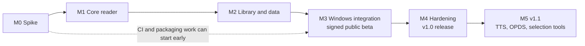

# Glacier Books — Development Milestones

Development plan for the Windows port described in [windows-migration-spec.md](windows-migration-spec.md). References use the spec's IDs: `D#` = decision, `F#` = feature in the feature inventory.

Development name: **Foliate4Win**. Product name: **Glacier Books**, app ID `glacier-books` (D13).

## At a glance

Six milestones, each closed by an exit gate. v1.0 ships after M4, v1.1 after M5. No dates are set yet: the M0 spike produces the estimates for M1–M5.

| Milestone | Goal | Features | Ends with |
| --- | --- | --- | --- |
| M0 Spike | Prove `foliate-js` in Tauri/WebView2 and get estimates | F1 (minimal) | Go/no-go, test corpus, estimates |
| M1 Core reader | A book reads end to end with all view settings | F1, F6–F11, F16, F20 | Reader feature-complete for reading |
| M2 Library and data | Library, annotations, persistence, Linux import | F2–F5, F12–F14, F25 | Imported Linux data reopens correctly |
| M3 Windows integration | Windows integration, packaging, signing, CI | F26, F27 | Signed public beta |
| M4 v1.0 hardening | Remaining v1.0 features, accessibility, release | F15, F17–F19 | v1.0 on Store, GitHub, portable zip |
| M5 v1.1 | Network features and text-to-speech | F21–F24 | v1.1 release |

## Definition of done (every task)

- [ ] ESLint and `cargo clippy` pass; new logic has unit tests (Rust or JS).
- [ ] All user-visible strings go through `_()` / `ngettext()` (D16).
- [ ] Works with keyboard only and in light and dark mode.
- [ ] Builds for x64 and ARM64 in CI.
- [ ] Behaves as Foliate 3.3.0 on the test corpus where a Foliate feature is ported.

---

## M0 — Spike

**Goal:** prove the architecture with the smallest working reader and turn the unknowns into numbers.

| ID | Task | Refs | Done when |
| --- | --- | --- | --- |
| M0-01 | Create the `glacier-books` repository: GPL-3.0-or-later `LICENSE`, `README`, `CONTRIBUTING`; add `foliate-js` as a git submodule | D5, D10 | Repo builds from a fresh clone with `--recursive` |
| M0-02 | Copy `src/reader`, `src/opds`, `src/selection-tools` from Foliate 3.3.0 with a provenance note (upstream commit hash) | D5 | Files present; `UPSTREAM.md` records the source commit |
| M0-03 | Scaffold Tauri 2 with a plain-JS frontend (no UI framework); decide the dev-server/bundling approach | D1, D3 | `tauri dev` opens an empty window |
| M0-04 | Rust `book://<token>` protocol: token → path map, streams the file to the page | Arch. | Page fetches a book and wraps it in a `File` |
| M0-05 | Minimal reader page: open dialog → `foliate-js` view → next/previous page | F1 | Turns pages in an EPUB |
| M0-06 | Assemble the test corpus: at least one book per F1 format, plus a right-to-left and a vertical-writing book; only redistributable (public-domain/open) books | Acceptance | Corpus committed or fetched by script |
| M0-07 | Side-by-side check of the corpus against Foliate on Linux; log rendering differences | Risk 1 | Difference log with an owner per item |
| M0-08 | CI skeleton: unsigned x64 and ARM64 builds on GitHub Actions | CI | Both artifacts built on every push |
| M0-09 | Measure baseline performance and fix the v1.0 targets (proposed: 1,000-book library and 5 MB EPUB each open in under 2 s) | Acceptance | Targets written into the spec |
| M0-10 | Estimate M1–M5 and set dates | — | Dates added to this document |

**Exit gate**

- [ ] Every format in F1 opens in the spike.
- [ ] Rendering-difference log reviewed; no blocker without a workaround.
- [ ] Test corpus and performance targets agreed.
- [ ] Estimates and dates for M1–M5 recorded.
- [x] D13 decided (name, app ID, icon).

---

## M1 — Core reader

**Goal:** reading works completely; library and persistence come in M2.

| ID | Task | Refs | Done when |
| --- | --- | --- | --- |
| M1-01 | Rust `settings` module: port every key and default from `com.github.johnfactotum.Foliate.gschema.xml` to `settings.json`; broadcast changes to all windows | Platform services | Changing a setting in one window updates all others |
| M1-02 | i18n: build step compiling `po/*.po` to JSON; `_()` / `ngettext()` helper; locale from Windows via `Intl` | D16 | UI shows German strings with a German Windows locale |
| M1-03 | Fluent design foundation: CSS tokens, light/dark, Mica backdrop, Segoe UI Variable, Fluent icons; base components (button, dialog, flyout, slider, list, toolbar) | D4 | Component sample page passes keyboard and contrast checks |
| M1-04 | Reader window shell: toolbar, sidebar, navbar; one window per book | Arch. | Two books open in two windows |
| M1-05 | Port `reader.js` / `reader.html` as the reader view module; replace `webView.exec('reader.*')` with direct calls | Arch. | No `postMessage` bridge left in the reader |
| M1-06 | Paginated and scrolled layout (Ctrl+M) | F6 | Toggle works on all corpus books |
| M1-07 | View preferences dialog (line height, justify, hyphenate, margins, columns, max sizes, brightness, invert, animation, autohide cursor) | F7 | All `viewer.view` keys editable and applied live |
| M1-08 | Fonts: system font list from Rust (`font-kit` or DirectWrite); serif/sans/mono/default, size, minimum size, override | F8 | All `viewer.font` keys applied |
| M1-09 | Reading themes from `src/themes.js`; app colour scheme with "follow system" | F9 | Switching Windows to dark mode updates open windows |
| M1-10 | Table of contents, navbar progress slider, go to location (Ctrl+L) | F10 | Navigation works on every corpus book |
| M1-11 | Search in book with next/previous | F11 | Ctrl+F, Ctrl+G, Ctrl+Shift+G work |
| M1-12 | Footnote popups | F16 | Footnotes open in an in-page popover |
| M1-13 | Keyboard shortcuts: map GTK accelerators (`src/book-viewer.js:748-776`) to `KeyboardEvent.key`; shortcut help dialog (Ctrl+?) | F20 | Every listed shortcut works |

**Exit gate**

- [ ] A corpus book reads end to end with all view settings.
- [ ] F1, F6–F11, F16, F20 pass their parity check.

---

## M2 — Library and data

**Goal:** books, progress and annotations persist in Foliate's JSON format; Linux users can bring their data.

| ID | Task | Refs | Done when |
| --- | --- | --- | --- |
| M2-01 | Rust `library` storage: Foliate-compatible per-book JSON; 1 s debounce; atomic write (temp file + rename); one shared in-memory record per book across windows | D15, Write rules | Killing the app mid-write never leaves a broken file |
| M2-02 | Extended file-name encoding: `*` → `%2A`, `%` prefix on reserved device names, SHA-256 for identifiers over 200 characters; lookup falls back to the plain Foliate name | File-name encoding | Unit tests cover each case |
| M2-03 | Case-collision detection with hashed-name fallback | Risk 5 | Two identifiers differing only by case keep separate data |
| M2-04 | URI store: `~`-relative paths, `file:///C:/...`, UNC as `file://server/share/...`, case-insensitive matching, `\` and `/` | Paths | Unit tests cover each path form |
| M2-05 | Save `metadata`, `progress`, `lastLocation`; reopen at the last location | — | Reopened book lands on the same page |
| M2-06 | Cover cache: PNG scaled to `cover-size` in `%LOCALAPPDATA%\glacier-books\cache` | F2 | Covers appear without re-parsing the book |
| M2-07 | Library window: grid and list view, cover toggle and size | F2 | Matches Foliate's library views |
| M2-08 | Library search and filter | F3 | Same results as Foliate on the same data |
| M2-09 | Open by drag and drop, Open dialog and command-line argument | F4 | All three open a reader window |
| M2-10 | Remove book (deletes JSON and cover) | F5 | No files left behind |
| M2-11 | Annotations with colours and notes | F12 | Annotations survive restart and show in all windows of the book |
| M2-12 | Bookmarks (Ctrl+D) | F13 | Bookmarks survive restart |
| M2-13 | Import/export annotations as JSON, HTML, Markdown, Org | F14 | Round trip JSON export → import loses nothing |
| M2-14 | "Locate file…" prompt for missing books; stores the new path | F25, D11 | Moved book re-links and keeps its data |
| M2-15 | Rust `import` module and UI: folder or `.zip` source; rename invalid file names; folder scan matching books by identifier; merge (newer `lastLocation`, annotations by CFI, nothing deleted); summary dialog | D8 | Steps 1–5 of "Linux import" work on a real Foliate data folder |

**Exit gate**

- [ ] Imported Linux data reopens at the same location with all annotations.
- [ ] F2–F5, F12–F14, F25 pass their parity check.

---

## M3 — Windows integration

**Goal:** the app behaves like a Windows app and ships as a signed public beta.

| ID | Task | Refs | Done when |
| --- | --- | --- | --- |
| M3-01 | Rust `shell` module: `tauri-plugin-single-instance` forwarding file/URL arguments | Platform services | Opening a file from Explorer while running opens it in the running instance |
| M3-02 | Window state with `tauri-plugin-window-state` | Platform services | Size, position, maximised, full screen restored |
| M3-03 | File associations: HKCU ProgIDs (installer) and `uap:FileTypeAssociation` (MSIX) for `.epub .mobi .azw .azw3 .kf8 .fb2 .fbz .cbz .pdf`; PDF only as "Open with" | Platform services | Double-click opens the book; PDF default unchanged |
| M3-04 | Keep screen awake: `PowerCreateRequest(PowerRequestDisplayRequired)` while a reader window is focused | F26 | Display stays on while reading, sleeps otherwise |
| M3-05 | External links via `tauri-plugin-opener`, never inside the app | Security | Links in books open the default browser |
| M3-06 | Tauri capabilities per window (least privilege) | Security | Capability files reviewed |
| M3-07 | About dialog with app, WebView2 and Windows versions; local crash logs, no telemetry | F27, D18 | Crash writes a log under `%LOCALAPPDATA%\glacier-books` |
| M3-08 | WebView2 runtime: Evergreen bootstrapper for Store/installer; message with download link for portable | Packaging | Clean VM without WebView2 handled for each package |
| M3-09 | Packages: NSIS per architecture (per-user, no admin), MSIX bundle (x64 + ARM64), portable zip with `data\` next to the exe | D7, D19 | All three install and run on clean VMs |
| M3-10 | Signing: SignPath Foundation onboarding and CI signing for NSIS and portable exe | D14 | Signed artifacts from CI; publisher shown correctly |
| M3-11 | Tauri updater: separate signing key in CI secrets, signed `latest.json` on GitHub Releases; check at most daily, ask first, never while a book is open | Updater rules | Beta N updates to beta N+1 |
| M3-12 | Full CI pipeline: lint → tests → `po` compile → `tauri build` → sign → package → draft GitHub Release | CI | One tag produces all artifacts |

**Exit gate**

- [x] D14 decided (SignPath Foundation).
- [ ] SignPath Foundation application approved.
- [ ] Signed beta installs on clean Windows 10 22H2 and Windows 11, x64 and ARM64.
- [ ] Public beta published on GitHub Releases.

---

## M4 — v1.0 hardening and release

**Goal:** remaining v1.0 features, quality bar met, released on all three channels.

| ID | Task | Refs | Done when |
| --- | --- | --- | --- |
| M4-01 | Selection flyout: copy, copy with citation, highlight, search | F15 | Matches Foliate's selection menu |
| M4-02 | Image viewer: zoom, rotate, invert, copy, save | F17 | All image shortcuts (`src/image-viewer.js:46-53`) work |
| M4-03 | EPUB media overlays | F18 | Read-along audio plays and highlights |
| M4-04 | Print (Ctrl+P) via WebView2 print dialog | F19 | Prints the current section |
| M4-05 | Accessibility: keyboard-only pass, Narrator labels on every control | Acceptance | Narrator announces every control |
| M4-06 | High DPI: 100 %, 150 %, 200 %, moving between monitors | Acceptance | No layout breaks |
| M4-07 | Translations: extract all strings, update the template, verify plural forms | D16 | Untranslated-string check in CI passes |
| M4-08 | Uninstall keeps user data unless "Remove my data" is ticked | Acceptance | Verified for NSIS and MSIX |
| M4-09 | Name and trademark check for "Glacier Books"; Store listing with source link | Risk 7 | Check documented |
| M4-10 | Windows App Certification Kit and manual Partner Center submission | D7 | Store certification passed |
| M4-11 | Run the full v1.0 acceptance list from the spec | Acceptance | All items ticked |
| M4-12 | Release v1.0: Store, signed GitHub installer, portable zip | D7 | All three channels live |

**Exit gate**

- [ ] All v1.0 acceptance criteria in the spec pass.
- [ ] F15, F17–F19 pass their parity check.
- [ ] v1.0 published on all three channels.

---

## M5 — v1.1

**Goal:** network features and text-to-speech.

| ID | Task | Refs | Done when |
| --- | --- | --- | --- |
| M5-01 | TTS prototype first: WinRT `SpeechSynthesizer` → stream played through `MediaPlayer`; map SSML `<mark>` timed cues to the events `tts.js` expects | D9, Risk 2 | Marks arrive in sync on a sample chapter |
| M5-02 | Rust `tts` module and port of `src/tts.js`: play, pause, stop, voice list and rate from system voices | F21 | Highlights sentence by sentence |
| M5-03 | Rust `net` module: HTTP for OPDS, bypassing CORS; granted to the library window only | Arch. | Catalog requests work without WebView CORS errors |
| M5-03a | Rust `net_lookup` command for selection tools: takes `{provider, text}`, reaches only `*.wikipedia.org`, `en.wiktionary.org` and `translate.googleapis.com`, refuses every other host; translate provider swappable | Security, Risk 3 | Unit test shows a request to any other host is refused |
| M5-03b | Reader window capability: add `net_lookup` only, never the general `net` module | Security | Capability file reviewed; calling `net` from the reader fails |
| M5-04 | Selection tools: Wiktionary, Wikipedia, Google Translate in the in-page popover iframe, requests through `net_lookup` | F22 | All three return results |
| M5-05 | OPDS catalogs: `catalogs.json`, the six built-in catalogs, browse, search, add/rename/remove | F23 | Every built-in catalog browses |
| M5-06 | OPDS downloads saved by Rust and opened in the app | F23 | Downloaded book opens in a reader window |
| M5-07 | `opds:` protocol: `uap:Protocol` (MSIX) and `tauri-plugin-deep-link` (installer) | F24 | `opds://` link opens the catalog |
| M5-08 | Release v1.1 on all three channels | D7 | All channels live |

**Exit gate**

- [ ] TTS highlights sentence by sentence.
- [ ] Every built-in catalog browses and downloads.
- [ ] F21–F24 pass their parity check.

---

## Recurring work

- **Upstream sync** (every milestone): compare Foliate's `src/reader`, `src/opds`, `src/selection-tools` against the commit in `UPSTREAM.md`; bump the `foliate-js` submodule; send rendering fixes upstream to `foliate-js` (Risk 1, Risk 4).
- **Corpus regression** (every milestone): re-run the test corpus on x64 and ARM64.

## Decisions made during planning

**Selection tools vs. reader permissions — resolved (spec D20).** The reader window keeps no access to the general `net` module. Selection tools (F22) stay in the reader window's in-page popover and reach the network through one narrow Rust command, `net_lookup`, limited to `*.wikipedia.org`, `en.wiktionary.org` and `translate.googleapis.com`. A separate lookup web view was rejected: stronger isolation, but a second native window to position and focus over the selection. Implemented by M5-03a, M5-03b and M5-04.

## Points to settle

1. **Spec wording.** The spec's Overview still points to "Open decisions"; that section is now "Decisions" and all decisions are settled. The M0 and M3 gates that waited on D13 and D14 are already met and are ticked above.
